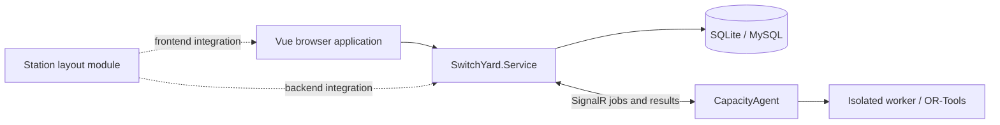

> **Historical archive.** Original path: `README.en.md`. [Current manual](../../en/01-overview.md) · [中文](../../zh-CN/01-overview.md) · [Archive index](../README.md). Commands, behavior, and test outcomes below retain their historical context.

# SwitchYard

> **Complete documentation (11 October 2026): [English manual](../../en/README.md) · [中文目录](../../zh-CN/README.md).** Original content below is preserved. Use the current manual for implemented behavior, configuration, model versions, and build instructions.

[中文](README.zh-CN.md)

SwitchYard is a toolkit for teaching railway yard and hub operations, preparing station plans, and running calculations. It includes hump profile design, rolling simulations, station capacity analysis, operation process editing, and course materials. This guide describes the current repository implementation; project files and lockfiles are the source of truth for dependency versions.

## Documentation

| Task | Guide |
| --- | --- |
| Learn the interface, accounts, languages, and course controls | [User guide (Chinese)](../guides/User-Guide.md) |
| Configure and start the complete system locally | [Getting started (Chinese)](../guides/Getting-Started.md) |
| Prepare layouts, routes, plans, and capacity calculations | [Capacity guide (Chinese)](../guides/Capacity.md) |
| Edit activities, events, precedences, and anchors | [Operation processes (Chinese)](../guides/operation-process.md) |
| Design a hump profile and run headway checks and simulations | [Hump guide (Chinese)](../guides/Hump.md) |
| Connect an independent solver | [CapacityAgent](../development/capacity-agent.md) |
| Develop the frontend and reuse UI components | [Frontend development (Chinese)](../development/frontend.md) |
| Deploy the API and static frontend | [Deployment (Chinese)](../guides/Deploy-Instruction.md) |
| Operate and back up a deployment | [Operations (Chinese)](../guides/Operations-Recommendations.md) |
| Understand deletion scopes, references, and result invalidation | [Deletion lifecycle](../../zh-CN/10-api-data-reference.md) |
| Migrate SQLite data to MySQL | [Database migration (Chinese)](../guides/SQLite-to-MySQL-Migration.md) |
| Embed the standalone station layout module | [Module overview](../development/station-layout.md) / [Integration guide (Chinese)](../development/station-layout-integration.zh-CN.md) |

General guides live in `doc/`; the detailed process model and API guide is maintained in `docs/operation-process.md`.

## Current capabilities

| Module / route | Implemented features |
| --- | --- |
| Hump `/hump` | Instance management, plan view, wagon and calculation conditions, profile design, energy-height calculations, headway checks, 2D and 3D rolling simulations |
| Capacity `/capacity` | Station layouts, route design, calculation parameters, operation processes, train templates, train operation plans, model solving, and unified 2D/3D simulation |
| Sketch Layout Planning `/sketchlayout` | Scheme CRUD, polygon facilities, circular gates, straight/curved links, alternative process plans, SLP flow diagrams and occupancy conflict estimates |
| Analysis within Operation Plan | Plan chart, occupation time tables, bottleneck analysis, and capacity category summaries |
| Courses `/courses` | Course navigation, study content, videos, PDF slides, and fill-in-the-blank exercises |
| Accounts | Registration and sign-in, profile and password changes, administrative user and hump-instance management, and instance authorization |
| Standalone station layout | Reusable Vue package, injected host gateway, shared document contracts, and backend services |

The separate **Result Analysis** tab in the capacity workspace is still a placeholder. Implemented analysis views are inside **Operation Plan**. The traction-calculation section contains a frontend sample rather than a connected production calculation. The Simulation tab offers a 2D/3D switch with shared playback controls, movement sequence, and Gantt chart. Switching views preserves playback position and Gantt settings; leaving the tab pauses playback. The 3D view displays station geometry and movements; it is not the capacity solver.

The interface supports Chinese and English. Capacity analysis, courses, and other updated workspaces use small circular buttons with hover labels and dividers for resizable panels. The hump module retains its original buttons, headings, toolbars, and panel styles; arrows expand or collapse the side panels in the profile designer. The independent station layout module retains its own toolbar design. Names, descriptions, and teaching content supplied by users are not automatically translated.

## Preview the interface

Frontend requirements: **Node.js 20.19+ within 20.x, or 22.12+**. Use **22.18+ or 24** for tests that load TypeScript directly. Keep the repository layout intact: the frontend depends on the sibling `SwitchYard.StationLayout/frontend` package.

From the repository root:

```powershell
cd switchyard-vue
npm ci
npm run dev -- --host 127.0.0.1
```

The development port is fixed at `5173`. Vite reports an error if it is occupied instead of silently choosing another port. These development pages use local fixtures and do not require a business database:

- [Workspace preview](http://127.0.0.1:5173/dev/workspace-style.html): production UI components with local sample data.
- [Interactive process example](http://127.0.0.1:5173/dev/operation-process.html): changes are stored only in the current page's memory.

The workspace preview accepts `?lang=en`, `?page=hump&lang=en`, and `?page=course&lang=en`. The process example accepts `?lang=en`. These pages are development entries and are not included in the production build.

## Run the complete system

The API targets **.NET 8**, while CapacityAgent targets **.NET 10**. The shared station module and its smoke tests target both. Use the **.NET 10 SDK** for a complete solution build, and ensure the **ASP.NET Core 8 runtime** is available to run the API and .NET 8 tests. See [Getting started](../guides/Getting-Started.md) for environment checks, database setup, and required configuration.

1. Configure API bindings, JWT settings, and both business database sections using the getting-started guide.
2. From the repository root, with those settings in place:

   ```powershell
   dotnet run --project SwitchYard.WebApi/SwitchYard.Service --no-launch-profile
   ```

3. Start the frontend. In development, the default API follows the browser's hostname using HTTP port `7297`: `http://localhost:5173` connects to `http://localhost:7297`, and a LAN address connects to that same host on port `7297`. To select a different API, set an explicit override in `switchyard-vue/.env.development.local`:

   ```dotenv
   VITE_API_BASE_URL=http://localhost:7297
   ```

4. Prepare the required business template/account data and sign in. Schema initialization alone does not seed a working teaching dataset: user creation currently depends on default hump template `001`, so registration cannot complete against an empty database without that template.
5. For **Model Solving**, start and connect [CapacityAgent](../development/capacity-agent.md), then select an available agent and model in the web interface.

The API explicitly calls `UseUrls` with `WebApi:Hosts`. Do not infer its actual port from `launchSettings.json` alone; check the startup log. Development defaults bind to `http://0.0.0.0:7297` and retain `http://localhost:5102` for compatibility. This keeps the original primary port `7297` after a restart or network change without requiring a fixed network-adapter IP. Open the service through `localhost` or the machine's actual address.

`VITE_API_BASE_URL` is read at development-server startup or build time. Restart Vite or rebuild after changing it. Use the API root URL, without appending `/api`: authentication uses `/api/Auth/...`, while business routes include `/Hump/...`, `/StationLayout/...`, and `/OperationPlan/...`.

## Architecture and directories



| Directory | Purpose |
| --- | --- |
| `switchyard-vue/` | Vue 3, TypeScript, Vite, Element Plus, Pinia, vue-i18n, and Three.js frontend |
| `SwitchYard.WebApi/SwitchYard.Service/` | ASP.NET Core 8 API, authentication, authorization, Dapper database access, and agent coordination |
| `SwitchYard.WebApi/SwitchYard.Hump/` | Hump calculation library |
| `SwitchYard.WebApi/SwitchYard.Capacity/` | Capacity models and shared contracts |
| `SwitchYard.WebApi/SwitchYard.CapacityAgent/` | Independent .NET 10 agent and OR-Tools workers |
| `SwitchYard.StationLayout/frontend/`, `backend/` | Reusable station layout module; the host supplies persistence and authorization |
| `SwitchYard.WebApi/*Tests/` | Backend smoke and integration tests |
| `switchyard-vue/tests/`, `checks/`, `dev/` | Frontend tests and development fixtures |
| `scripts/deploy/` | systemd unit, environment template, and installation script |
| `LocalData/` | Local databases and development data, excluded from version control |

Authentication uses JWT access tokens and refresh tokens. The frontend sends a SHA-256 password value; the backend stores an Argon2 password hash. See the account and deployment guides for actual session and permission behavior.

## Build and verify

Run in `switchyard-vue`:

```powershell
npm run type-check
node node_modules/vite/bin/vite.js build --mode production
npm run preview -- --host 127.0.0.1
```

The output is `switchyard-vue/dist`; the preview port defaults to `4173`. Set the deployment API address before building. Running type checking and Vite separately also avoids argument-forwarding issues in some Windows/npm versions.

Relevant UI, simulation, and process regressions:

```powershell
node --test --test-isolation=none tests/paneDivider.test.mjs tests/simulationPerformance.test.mjs tests/simulationViewport.test.mjs tests/threePageLifecycle.test.mjs checks/operationProcess.test.mjs
```

See frontend verification（历史资源未随仓库提供 / historical resource not shipped: `switchyard-vue/tests/README.md`） for further tests and visual fixtures. With the .NET 10 SDK, build the backend solution from the repository root:

```powershell
dotnet build SwitchYard.WebApi/SwitchYard.Service.sln
```

The operation process integration tests（历史资源未随仓库提供 / historical resource not shipped: `SwitchYard.WebApi/SwitchYard.OperationProcess.Tests/README.md`） use a temporary SQLite database and test-only authentication.

## Troubleshooting

| Symptom | Check |
| --- | --- |
| UI loads but business data does not | API status, configured root URL, Vite restart, login, and instance permissions |
| No available solver | Agent connection to the same API, account activation/password status, access rules, model version, and free slots |
| Empty layout or simulation | Selected instance/scheme/plan and saved geometry, routes, and operation data |
| Empty course materials | Server resource directory, manifest responses, and file permissions |
| Refreshing a frontend route returns 404 | History-mode fallback to `index.html` in the static server |
| Built frontend still calls an old API | Rebuild after changing the API URL; it is embedded in the bundle |

## Maintenance and license

Maintained by the Railway Yards and Hubs course team, School of Traffic and Transportation, Beijing Jiaotong University, including Liao Zhengwen.

Repository: [Gitee / SwitchYard](https://gitee.com/lzw37/SwitchYard). Licensed under the [MIT License](../../../LICENSE). Update the relevant usage guide, English overview, and verification instructions when changing behavior.

## Sketch Layout Planning

Job quantity settings in the Process design toolbar opens a table with one quantity per process plan (integers from 1 to 1,000,000), shared by all of its parallel chains. Apply updates all plans together; cancelling or closing leaves their quantities unchanged. Batch changes support a single undo/redo and are persisted with Save scheme.

Open `/sketchlayout` from the home page. Authentication and current user status/roles come from hump; only business documents are stored in the independent `SketchLayoutDatabase`. Users manage their own schemes and administrators can manage all schemes.

Use Edit in the scheme manager to change the name and description directly in that table row, with Save and Cancel actions; the main page no longer has metadata inputs. Saving updates the manager and top scheme selector, while cancelling leaves data unchanged. Editing another scheme does not switch the current canvas. Editing the current scheme’s metadata preserves unsaved drawing and process changes and their undo/redo history.

New scheme inserts a draft row at the top of the manager table. Enter its name and description and select Save to create it, or Cancel to remove the draft. Failed saves retain the inputs for retry. Creating a scheme preserves the current drawing and unsaved changes; use Open to switch to the new scheme. The first scheme is loaded automatically. New, Open, Edit, Delete, Save and Cancel use the application’s standard circular icon buttons, with action names shown on hover.

Draw polygons and gates, connect centers/vertices/edge midpoints, add link anchors, then click facilities in sequence to create process chains. Each scheme supports multiple process plans for grouping parallel chains. Cards show each chain's name, time per job, total time and draft status. Add a parallel chain, select its card to append facilities on the canvas, set the shared plan quantity once above the list, and edit its name and step durations in the side panel. Duplicate and delete operate on the selected chain; duplicating a plan copies all its chains. Analysis combines every chain from every plan in the layout, with no plan selector, and checks conflicts across plan boundaries as well as within each plan. Equal chain names or IDs in different plans remain separate; conflict rows include their source plan and chain names. Drafts can be saved, but every chain across all plans needs at least two facilities before analysis. Use Save to persist the entire document atomically. Revision checks prevent stale updates/deletes; referenced elements cannot be deleted until their processes are updated.

Layout design and process design fill the window space remaining below the main toolbar and tabs. The canvas and side panels resize with the window; chain lists and steps scroll within their own panels.

The process data hierarchy is `plans[] → chains[] → steps[]`. A plan stores `executionMode: "parallel"` and a single `quantity`; each chain owns its ID, name and ordered steps. The layout's root `analysisSettings` stores the shared analysis horizon and SLP thresholds for all plans. Chains have no sequencing dependency and need not start simultaneously. Missing `executionMode` defaults to parallel semantics. When `analysisSettings` is absent, matching legacy plan settings are retained; differing settings use the common defaults (3600 seconds and A/E/I 0.8/0.5/0.2), independent of plan order or editing selection. Adjust and save these values on the analysis page. Existing chain steps are preserved without a database schema migration.

Process design places the canvas, a vertical parallel-chain list, and chain properties/steps side by side. Drag the list's left divider to share width with the canvas, or its right divider to share width with properties. Arrow keys adjust width and double-click restores defaults. The chain list scrolls independently; narrow windows can scroll the three-column workspace horizontally. Width changes are view state and do not modify the saved document.

The chain editor alternates separately numbered facility dwell and logistics-link travel cards. Facility cards edit dwell time only; link cards show the connection name, travel direction and travel time, with a selector for alternative connections. List items show time per job and total time on one row (the plan quantity multiplied by this chain's time per job). Facility, link, dwell and travel details remain in the steps panel. Existing documents retain `steps[].dwellSeconds` and `steps[].incomingLinkId/travelSeconds`: the latter fields represent the independent travel operation before the destination facility. Truncating a facility also removes the incoming travel operation and subsequent steps.

Each process plan has one job quantity, edited once above the parallel-chain list. Every parallel chain and every dwell/travel step inherits it; chain cards and the steps panel do not repeat or edit the quantity. Changes update chain total times, SLP flows and crossing passage counts, and support save, undo and redo. Legacy plans without `quantity` adopt the first chain's former quantity (1 for an empty plan), remove all chain quantities, and persist the normalized document on save. An explicit plan quantity takes precedence. No database table migration is required. Analysis counts total chain runs as the sum of plan quantity multiplied by chain count; shared resources and repeated traversals still aggregate passage counts.

Use `POST /SketchLayout/schemes/{id}/analysis`, replacing the former per-plan analysis route. The response reports `scope: "all-plans"`, plan/chain/job counts and plan-qualified chain IDs for conflicts. Whole-layout analysis supports up to 5000 approximating line segments, 50,000 chain pairs and 5 million occupancy comparisons. Excessive work returns an explicit error instead of omitting plans or returning partial results.

The canvas extends in every direction, with negative and remote coordinates supported for facilities, anchors and crossing markers. The grid covers the visible viewport. Opening a scheme or selecting Fit canvas frames its contents, including anchors and visible crossing markers; storage, process design and analysis retain the same coordinates without cropping or moving existing objects.

The canvas follows StationLayout's dot grid with independent visibility and snap switches, and a spacing of 1–500 drawing units (default 20). New vertices, gates and link anchors snap to the grid. Whole-facility moves snap the first vertex or center while preserving the shape. Grid dots are thinned when zoomed out without changing snap spacing. Grid preferences are saved with the scheme and included in undo/redo; opening a legacy scheme does not alter its geometry.

The toolbar's Show link names switch displays all logistics link names when enabled, and only the selected link's name when disabled. Selected names remain bold. It defaults to off to preserve the legacy display, is saved with the scheme, and supports undo/redo. The process canvas retains step labels for the current chain.

Link anchors define polyline corners. The toolbar's Rounded corners switch defaults to on and applies tangent circular fillets as in StationLayout; switching it off draws a polyline through the anchors. The default radius is 100 drawing units and shrinks when short segments or neighboring fillets need more room. Switching modes preserves anchor coordinates, is saved with the scheme, and supports undo/redo. Direction arrows follow the midpoint and tangent of the displayed path.

The separate Polygon fillets switch defaults to on, with a default radius of 150 drawing units. It rounds only right and obtuse interior angles using tangent circular arcs, retaining acute, straight and reflex corners. Neighboring fillets shrink to fit short edges, including the closing edge. Switching it off shows the original polygon. Vertices and link endpoints retain their coordinates; selected polygons still expose their original vertices for editing, and double-clicking a rounded edge projects the inserted vertex onto the original edge. The setting is saved with the scheme, supports undo/redo and is shared by the process canvas.

The Route crossings button computes intersections between the current polylines or circular arcs once and creates independent red circle markers. Shared terminals and overlapping spans are excluded; coincident intersections are merged. Show route crossings only controls visibility. Link or curve-display edits never move existing markers. Every click clears previous markers and regenerates them from current intersections, restarting names at “Route crossing 1” and resetting radii and occupancy overrides to defaults. No intersections leaves the marker collection empty. One undo restores all previous markers and their properties. Each marker records the IDs and names of participating routes. Its properties show those routes with current and recorded names when renamed; deleted routes retain their recorded names and are marked as deleted. Select or drag markers, edit their name, center and radius (5–200) in the side panel, or delete them. Markers and visibility are saved with the scheme and support undo/redo. Up to 1000 markers are supported; exceeding the limit preserves existing markers without a partial replacement. Markers are not process steps, but their recorded sources drive the crossing probability analysis.

Layout analysis uses two side-by-side panes: Conflict analysis and Flow relationships tabs with settings and results on the left, and a shared layout canvas with pan and zoom on the right. Drag the vertical divider to resize the panes or double-click to reset. The left pane scrolls independently, keeping the canvas visible when switching tabs. Links use the AEIOU grade of their endpoint facility pair; hovering shows the grade, relative intensity and combined bidirectional facility-pair flow. Parallel links between the same facilities share that grade. Saved crossing circles use a brighter continuous 0–75% load spectrum at 32% opacity. Loads at or above 75%, including above 100%, use the highest red. Hovering shows load, conflict probability and source routes. Unavailable loads are gray, distinct from zero; known loads remain colored even when queue simulation exceeds its limits. Crossing, route and chain conflict probabilities in tables use a 0–100% numeric color scale, while load numbers use the same 0–75% scale as the circles. Both spectra have legends. All saved crossings appear in this read-only view, including markers hidden in the design view, without changing saved colors, visibility or geometry. Invalidated analysis results also clear stale canvas colors.

The Flow relationships card places the facility-pair table above a Richard Muther Activity Relationship Chart diamond matrix. Facilities follow layout order, and each unordered pair appears once, including zero-flow U relationships. For comparison with the flow analysis, each diamond shows the AEIOU grade above and total bidirectional flow below (in place of traditional reason codes). Hover or keyboard focus reveals full names, exact flow, relative intensity and directional flows, highlighting the two facility rows. Only calculated flow relationships are represented; non-flow reasons and X relationships are not inferred. Drag the horizontal divider between the table and chart to redistribute their heights within a fixed area; double-click to reset. Both parts retain independent scrolling and minimum usable heights. Large matrices scroll internally. Both analysis panes have minimum widths; very narrow windows can scroll horizontally.

The analysis page now reports conflict per passage at each saved crossing. It aggregates route passage counts across all plans, including repeated traversals. Expand a crossing to override occupancy seconds per source route, or reset to the automatic passage-weighted mean route travel time. The selectable models are Poisson arrivals with fixed occupancy (default), uniform arrivals with fixed occupancy, and Poisson arrivals with independent exponential occupancy (enter the mean). Rates are counts divided by the shared analysis horizon. Each row shows the probability that a randomly selected passage overlaps another source route's occupancy; the total is passage-weighted, not the probability of any conflict in the entire period.

For route i, let `Rᵢ=Σⱼ≠ᵢ λⱼ` and `Bᵢ=Σⱼ≠ᵢ λⱼmⱼ`. Fixed Poisson probability is `1-exp(-Bᵢ-Rᵢmᵢ)`; exponential Poisson probability is `1-exp(-Bᵢ)/(1+Rᵢmᵢ)`. The latter follows from stationary independently marked Poisson streams: earlier active occupations give the factor `exp(-Bᵢ)`, then the selected job's service time is integrated for future arrivals. See the M/G/∞ occupancy distribution in [MIT's Queueing Theory notes, page 5](https://ocw.mit.edu/courses/15-763j-manufacturing-system-and-supply-chain-design-spring-2005/22f4805864deb06eee85acc1601463ba_queueing_note.pdf). Uniform arrivals fix passage counts in `[0,H]`: condition on a selected start u, multiply independent no-conflict probabilities using clipped windows `[u-mⱼ,u+mᵢ] ∩ [0,H]`, then numerically integrate over u. This handles boundary effects without raising an averaged pair probability to a count. Integration uses absolute tolerance `1e-9`, depth 30, 1 million factor evaluations per marker and 5 million per document; nonconvergence is reported explicitly.

Each crossing also reports mean queueing delay `Wq` in seconds, mean waiting queue length `Lq` in jobs, and offered load `ρ`. The model is one exclusive FCFS server with unlimited waiting space, including same-route waiting. Delay excludes service and queue length excludes the job being served. Service uses the crossing occupancy override or weighted link travel time, never facility dwell. Crossings are evaluated separately without propagating upstream delays or applying priorities.

For Poisson arrivals, use M/G/1: `ρ=Σλᵢmᵢ`, `Wq=ΣλᵢE[Sᵢ²]/[2(1−ρ)]`, and `Lq=(Σλᵢ)Wq`. Fixed service uses `mᵢ²`; exponential service uses `2mᵢ²`, preserving the mixture of route durations. See [MIT's M/G/1 and P-K derivation](https://web.mit.edu/urban_or_book/www/book/chapter4/4.7.html). At `ρ≥1`, status is `unstable`; delay and queue length are null, with no finite steady state, while load remains uncapped.

Uniform arrivals use reproducible finite-window simulation: fixed counts, independent arrivals in `[0,H]`, initially empty queue and FCFS. Delay follows each arrival until service starts, including beyond H; queue length averages waiting population only over `[0,H]`. Do not apply steady-state Little's law to these two different observation windows. Load is `ΣNᵢmᵢ/H`, so an overloaded finite batch still has finite estimates. Limits are 20,000 passages, 64–2048 replications and 2 million events per crossing, and 8 million events per document. Exceeding a limit preserves load and reports `calculation-limit`; expanded rows show replication count and standard errors. A fixed seed and stable source ordering make identical inputs reproducible.

`crossingRisks[].queue` returns `model` (`mg1-fcfs` or `finite-uniform-fcfs`), `status`, `loadRatio`, `meanDelaySeconds`, `meanQueueLength`, `simulationRuns`, `delayStandardErrorSeconds`, and `queueLengthStandardError`. No traffic yields zero metrics; missing/deleted sources yield nulls. Queue and probability calculation statuses are independent. These are derived results and require no database migration.

Source routes at a marker are mutually incompatible; arrivals are assumed independent. The UI warns when a chain revisits or uses multiple sources, making that independence an approximation. These are planned occupancy overlaps before queues, priorities or dispatch; same-route headways and waiting times are outside this calculation. Poisson streams include earlier active occupations; uniform streams start within the window. Missing source records, deleted routes and no traffic have distinct statuses. A single active route gives zero cross-route conflict. Hidden markers remain included and analysis never regenerates geometry. After geometry edits, review the saved source records. The existing complete-chain uniform-start model below remains separate.

Persisted fields: `analysisSettings.crossingModel` is `poisson-fixed`, `uniform-fixed` or `poisson-exponential`; legacy documents default to `poisson-fixed`. `crossings[].sourceLinks[].occupancySeconds` is a nullable override from 0.01 to 31536000 seconds. The analysis response adds `crossingRisks[]` with counts, rates, occupancy, conditional and weighted probabilities, status and correlation warnings. These settings support save/reload and undo/redo without a database schema migration.

The canvas and properties panel sit side by side with a draggable vertical divider (double-click to reset, or use arrow keys). Normal mode selects objects on click and pans on background drag. In normal canvas mode, double-click a facility, entrance, crossing, or object label to rename it in place. Enter commits, Esc cancels, and blur commits valid names. Double-click logistics lines to rename directly at the pointer. Shift+double-click a logistics line or use Add anchor in its properties to add an anchor; right-click an anchor to delete it. Double-click polygon edges to add vertices, or their labels to rename them. A drawing button enters drawing mode; Esc discards the unfinished draft and returns to normal mode. Selected objects use a colored edge and bold name without a selection box. Edit polygon names and vertices, gate names/centers/radii, or link names and link anchors in the right panel. Connected ports retain their identities, and invalid geometry edits are rejected and reverted. Click the background or close button to clear selection. Property edits support undo/redo and are saved with the scheme.

SLP grades use bidirectional transfer quantities normalized against the maximum pair flow (configurable A/E/I thresholds: 0.8/0.5/0.2; lower positive flow O; zero U). These are application settings, not fixed SLP standards. Non-flow and X relationships are outside this calculation. See [Richard Muther & Associates](https://richardmuther.com/systematic-planning-methods/).

Conflict estimates assume independent uniform starts within a configurable horizon and fixed durations. Facilities, shared links and crossing/overlapping links are exclusive resources. Analysis follows the saved display mode and approximates each rounded corner with 24 segments; crossing links are treated as exclusive for their full traversal, giving conservative occupancy estimates. Conflict intervals are merged before integration against the triangular start-difference distribution. Results show the probability that a job pair conflicts at least once and expected conflicting job pairs, including distinct jobs of the same chain. They do not report the system-wide probability of any conflict.

Development creates a separate SQLite `sketchlayout.db`; configure `SketchLayoutDatabase__SqlliteConfig__DatabaseFile` for a persistent path. Production uses MySQL: provision `sketchlayout` using `scripts/deploy/sketchlayout-database.sql`, grant the service account access and provide the `SketchLayoutDatabase__MysqlConfig__*` environment variables from the deployment example. Tables initialize on startup. Existing deployments need these new settings before upgrading.

See the [Chinese implementation and API notes](README.zh-CN.md#sketch-layout-planning布置图分析) for endpoints, limits and verification commands.
