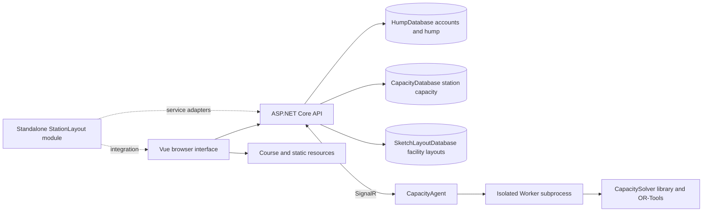

# SwitchYard overview

[Documentation](README.md) · [中文](../zh-CN/01-overview.md)

SwitchYard supports railway station and terminal teaching, layout design, and computational analysis. Its web interface brings together hump design and rolling calculations, station capacity analysis, operation process modeling, facility layout analysis, and course resources. Users can build schemes, enter operations, calculate results, and inspect simulations. Developers can also embed the station layout component in other applications.

This manual describes the repository implementation as of 11 October 2026. The displayed application version comes from the deployment setting `App:Version`; it is separate from the frontend package version and the CapacityAgent model version. Start with [installation](07-installation.md) to run a system, or the [user guide](02-user-guide.md) to use an existing service.

## Features and entry points

| Entry | Available work | Requirements and boundaries |
| --- | --- | --- |
| Home `/` | Enter modules and read feature introductions | `/capacity-preview` introduces the capacity module |
| Hump `/hump` | Instances, planar and vertical schemes, wagon and weather conditions, energy heights, speed and running time, headway curves, 2D and 3D playback | Business data requires login and instance access; calculations require complete geometry and parameters |
| Capacity `/capacity` | Station layouts, routes and timing, processes, trains and movements, occupancy charts, bottleneck and capacity summaries, agent solving, and simulation | Solving requires a separate agent; implemented analysis is within the operation plan workspace |
| Sketch layout `/sketchlayout` | Polygon facilities, entrances, directed operation routes, multiple workflows, SLP, operation conflicts, crossing probabilities, and queue analysis | Uses its own business database and the shared account system; crossing markers and workflows must be configured correctly |
| Courses `/courses` | Course navigation, videos, teaching materials, and exercises | Course endpoints allow anonymous reads; actual content depends on deployed resource directories |
| Profile `/userinfo` | View and edit personal information and change a password | Requires login; mandatory password changes redirect here |
| User management `/usermanagement` | Accounts, activation, roles, import, and password resets | Administrator feature; `/usermanager` redirects here |
| Hump instance management `/hump/instancemanagement` | Manage hump instances and their owners | Administrator feature |
| Standalone station layout module | Embed in another Vue application and connect host authentication and persistence | A reusable module requiring host adapters, rather than a ready standalone site |

The interface supports Chinese and English. User-entered names, descriptions, and teaching materials are not automatically translated. The sketch layout report exporter currently generates Chinese content; switching the interface to English does not translate the exported report.

## Three main workflows

### Hump design and calculation

1. Select an accessible instance and create or copy a planar rolling line.
2. Edit planar positions, switches, and retarders; define wagons and operating conditions.
3. Create a vertical profile scheme, enter gradient sections, and save it.
4. Create a calculation combination and inspect energy height, speed, and running time curves.
5. Define a headway check and inspect adjacent wagon relationships and 2D or 3D playback.
6. Recalculate after geometry or operating conditions change, then compare schemes.

See [hump design and simulation](03-hump.md). Headway curves and playback do not constitute a complete automatic compliance verdict against railway design standards.

### Station capacity analysis

1. Create a capacity instance and station scheme; edit or import its layout.
2. Define route endpoints, movement routes, and dwelling routes; generate and maintain Cell occupancy timing.
3. Build operation processes or train templates shared by the station scheme.
4. Add trains and movements to an operation plan, or generate an initial plan from processes.
5. Inspect plan charts, occupancy times, bottlenecks, and category summaries.
6. Select a compatible agent and solver settings, submit a job, and inspect its status.
7. Inspect the result, generate a saturated plan when appropriate, and play the plan in a planar or 3D view.

Initial process generation schedules events under process constraints. It does not guarantee conflict-free operation across trains. Capacity solving is a separate stage. The current model adjusts timing and resource choices for the supplied trains; see [capacity analysis](04-capacity.md) for the reported capacity formula. Its name should not be interpreted as a global search over all possible train counts.

### Facility layout and workflow analysis

1. Create a sketch scheme and draw facilities, entrances, and connecting routes.
2. Set route directions, check connectivity, and create one or more workflows.
3. Add facility steps, dwell times, and travel times to each operation, then set the quantity for each workflow.
4. Save the scheme and set a common analysis horizon and SLP thresholds.
5. Inspect layout-wide relationships, resource conflicts, crossing probabilities, and queue metrics.
6. Save and recalculate after changing facilities, routes, or workflows.

Facilities and routes in this general layout model are separate from the capacity module's Node, Link, Cell, and StationRoute entities. See [sketch layout analysis](06-sketch-layout.md) for assumptions, formulas, and conditions under which a metric is unavailable.

## Architecture

The browser edits and submits business data. The API authenticates requests, validates their scope, persists data, and coordinates calculations. Hump calculations run in the core library called by the service. CapacityAgent receives and schedules station capacity jobs; Worker subprocesses invoke the `SwitchYard.CapacitySolver` class library. The 3D interface displays and plays results; it does not replace the solver.

Dapper provides database access, with SQLite and MySQL supported. Each of the three database configuration sections selects its database type and connection. Accounts live only in HumpDatabase. Keep these databases separate: they contain identically named tables with different structures, such as `switch`.

Agent presence and solve jobs are held in API process memory. After an API restart, the job list is not a durable history. Business schemes, plans, and saved results are persisted in their respective tables. See [deployment and operations](08-deployment-operations.md) for backup coverage.

## Repository structure

| Directory | Responsibility |
| --- | --- |
| `switchyard-vue/` | Main frontend using Vue 3, TypeScript, Vite, Element Plus, Pinia, vue-i18n, and Three.js |
| `SwitchYard.WebApi/SwitchYard.Service/` | .NET 8 API, authentication, persistence, course resources, and solve coordination |
| `SwitchYard.WebApi/SwitchYard.Hump/` | Hump geometry, resistance, energy height, speed, and headway calculations |
| `SwitchYard.WebApi/SwitchYard.Capacity/` | Shared station, route, occupancy, and agent contracts |
| `SwitchYard.WebApi/SwitchYard.CapacityAgent/` | .NET 10 communication agent, job scheduling, and Worker resource management |
| `SwitchYard.WebApi/SwitchYard.CapacitySolver/` | .NET 10 solver library, model registration, OR-Tools, and Worker execution entry point; published with the Agent |
| `SwitchYard.WebApi/SwitchYard.CapacitySolver.Tests/` | Regression tests for shared domain objects, process constraints, and solver models |
| `SwitchYard.WebApi/SwitchYard.SketchLayout/` | Sketch geometry, validation, conflict, and queue calculations |
| `SwitchYard.StationLayout/` | Reusable frontend component and backend module targeting both .NET 8 and .NET 10 |
| `scripts/deploy/` | systemd service, example environment file, and setup scripts |
| `scripts/`, `tools/SQLiteToMySqlMigrator/` | SQLite to MySQL migration entry point and implementation |
| `docs/README.md`, `docs/MAINTENANCE.md` | Central documentation entry point and maintenance rules |
| `docs/archive/` | Earlier guides, reviews, and promotional materials grouped by topic |
| `docs/zh-CN/`, `docs/en/` | Matching current Chinese and English manuals |
| `LocalData/`, `switchyardvid/` | Local data and media; complete contents are not distributed with the source |

A local workspace may also contain `CellOccupancy/`, `PyStationCapacity/`, caches, and build output. Those two directories currently contain no version-controlled application source and are not required runtime components supplied by a fresh clone.

## Current implementation boundaries

| Area | Current behavior | Practical guidance |
| --- | --- | --- |
| Separate capacity results tab | Placeholder | Use the implemented analysis within the operation plan workspace |
| Traction calculation | Frontend example | Do not treat it as an integrated production calculation |
| Initial process plan | Validates each train's events and resource continuity, without cross-train conflict optimization | Inspect occupancy and run solving after generation |
| Model compatibility | Current station model is `2.5.0`; ordinary-train input requires at least `2.4.0`, and process references require `2.5.0` | Deploy the current API together with the current Agent and its Solver library |
| Minimum model version field | The service checks `minimumModelVersion` and raises the minimum for parameter sets and process references | The `v1` in the model ID is not a compatibility version; see the capacity chapter |
| Registration and teaching template | Registration requires hump template `001` | Prepare valid template and account data after schema creation |
| Full solution build | The `.sln` includes test projects not supplied in the repository | Use the application project build commands in the installation chapter |
| Historical test reports | Counts in older documents describe earlier runs | They do not establish validation of a current deployment |
| Data deletion | Cleanup is scoped by instance, scheme, plan, or object; referenced objects may be protected | Check the scope before deletion; see the API and data reference |

## Terminology

| Chinese | English | Meaning in SwitchYard |
| --- | --- | --- |
| 实例 | Instance | User-owned business container; hump and capacity instances are stored separately |
| 方案 | Scheme | A geometry or layout design; modules use distinct scheme entities |
| 节点 | Node | Station topology position |
| 连接或股道 | Link / Track | Layout connection between nodes; a named connection can represent a track |
| 轨道电路或占用单元 | Cell | Exclusive resource used by capacity solving and occupancy charts |
| 进路 | Route | Movement or dwelling path defined by topology and resources |
| 移动 | Movement | One train operation record, including a dwelling operation |
| 作业计划 | Operation plan | Trains and their movements within a station scheme |
| 作业过程 | Operation process | Template of activities, events, precedence, and resource constraints |
| 活动与事件 | Activity / Event | An activity spans time; events define endpoint times and locations |
| 次序 | Precedence | Minimum or exact interval between two events |
| 锚 | Anchor | Resource location constraint related to an event or route |
| 过程快照 | Process snapshot | Independent process constraints retained by a generated train |
| 计算代理 | CapacityAgent | Separate program that registers models and available resources and receives jobs |
| 饱和计划 | Saturated plan | New operation plan produced through the dedicated solve workflow |
| 布置图流程方案 | Workflow | Group of sketch operations sharing an operation quantity |
| SLP | Systematic Layout Planning | Layout relationship analysis using operation volumes in this module |

## Maintenance and license

The project is maintained by the Railway Stations and Terminals course team at the School of Traffic and Transportation, Beijing Jiaotong University, including Liao Zhengwen. The repository is [SwitchYard on Gitee](https://gitee.com/lzw37/SwitchYard), under the [MIT License](../../LICENSE). Update matching chapter numbers in both language directories when behavior changes. Interface localization and documentation translation are maintained separately.

Third party dependencies, templates, and assets retain their own licenses. Consult [licensing and third party notices](11-licensing.md) when distributing or updating the project, including license texts, dependency inventories, and outstanding evidence checks.
