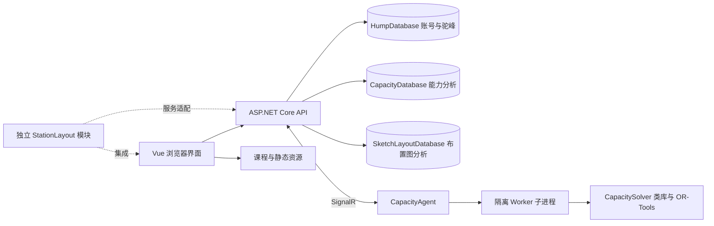

# SwitchYard 程序总览

[文档目录](README.md) · [English](../en/01-overview.md)

SwitchYard 面向铁路站场与枢纽课程教学、站场方案编制和计算分析。它将驼峰设计与溜放计算、车站通过能力分析、作业过程编排、设施布置分析和课程资源放在同一 Web 界面中。使用者可以逐步建立方案、输入作业、计算并查看结果；开发者还可以单独复用车站布置图控件。

本套说明对应 2026 年 10 月 11 日的仓库实现。界面版本号取自部署配置 `App:Version`，它与前端包版本及 CapacityAgent 模型版本不是同一个编号。安装前先阅读[安装与首次启动](07-installation.md)，直接使用现有服务时从[用户指南](02-user-guide.md)开始。

## 功能与入口

| 入口 | 可以完成的工作 | 使用条件与边界 |
| --- | --- | --- |
| 首页 `/` | 进入各模块，查看功能介绍 | `/capacity-preview` 是能力模块介绍页 |
| 驼峰 `/hump` | 实例、平面和纵断面方案，车辆及气象条件，能量高度、速度与运行时间，间隔曲线，二维和三维播放 | 业务数据需要登录及实例权限；计算依赖完整几何和参数 |
| 通过能力 `/capacity` | 站场图、进路和时间参数、作业过程、列车与移动、占用图表、瓶颈与能力汇总、代理求解及仿真 | 求解需单独运行计算代理；实际分析位于作业计划相关界面 |
| 布置图分析 `/sketchlayout` | 多边形设施、出入口、有方向的作业进路、多套流程、SLP、作业冲突、交叉点概率及排队分析 | 使用独立业务数据库，共用账号；几何交叉标记与流程需正确设置 |
| 课程 `/courses` | 课程目录、视频、课件和练习 | 课程接口允许匿名读取；实际内容依赖部署的资源目录 |
| 个人信息 `/userinfo` | 查看和修改资料、修改密码 | 需要登录；被要求改密时优先进入此页 |
| 用户管理 `/usermanagement` | 管理账号、激活、角色、导入及密码重置 | 管理员功能；`/usermanager` 重定向到此入口 |
| 驼峰实例管理 `/hump/instancemanagement` | 管理驼峰实例和所有者 | 管理员功能 |
| 独立站场模块 | 嵌入其他 Vue 应用，接入宿主认证与数据服务 | 是可复用模块，需要宿主适配，并非现成独立站点 |

界面提供中英文切换，用户输入的名称、说明、教学材料不会自动翻译。布置图报告导出当前固定使用中文内容；英文界面不意味着导出英文报告。

## 三条主要业务流程

### 驼峰设计与计算

1. 选择有权限的实例，建立或复制平面溜放线。
2. 编辑平面位置、道岔和减速器，建立车辆及作业条件。
3. 创建纵断面方案，填写坡段参数并保存。
4. 建立计算组合，检查能量高度、速度和运行时间曲线。
5. 编制间隔检验方案，查看相邻车辆关系和二维、三维播放。
6. 修改几何或计算条件后重新计算，再比较方案。

详见[驼峰设计与仿真](03-hump.md)。间隔页面的曲线与演示不能直接解释为完整规范的自动合格结论。

### 通过能力分析

1. 创建能力实例和站场方案，编辑或导入站场布局。
2. 定义进路端点、移动进路与停留进路，生成并维护 Cell 占用时间。
3. 建立方案共享的作业过程或列车模板。
4. 在作业计划中新增列车与移动，或从过程生成初始计划。
5. 检查计划图、占用时间、瓶颈及分类汇总。
6. 选择兼容的代理和求解设置，提交求解并查看状态。
7. 查看求解结果，必要时生成饱和计划，使用平面或三维视图播放。

初始计划生成负责按过程约束排列事件，不保证不同列车之间无冲突。能力求解是另一个阶段。当前模型调整既有列车的时间与资源选择；能力指标的计算口径见[通过能力分析](04-capacity.md)，不能把名称理解为自动搜索所有可能列车数量的全局最大值。

### 设施布置与流程分析

1. 创建布置图方案，绘制设施、出入口和连接进路。
2. 设置进路方向，检查连接关系，再建立一套或多套作业流程。
3. 为作业内容添加设施步骤、停留时间和走行时间，设置每套流程的作业数量。
4. 保存方案，设置统一分析时段和 SLP 阈值。
5. 查看全图作业关系、资源冲突、交叉点概率及排队指标。
6. 修改设施、进路或流程后保存并重新分析。

此模块中的设施和作业进路属于通用布局模型，与能力模块中的站场 Node、Link、Cell、StationRoute 是不同的数据体系。详细假设、公式和失效条件见[布置图分析](06-sketch-layout.md)。

## 程序架构

浏览器编辑并提交业务数据，API 负责认证、范围校验、持久化及计算协调。驼峰计算在服务调用的核心库中执行；通过能力优化由 CapacityAgent 接收和调度任务，Worker 子进程调用 `SwitchYard.CapacitySolver` 类库求解。三维界面负责呈现和播放，不负责替代求解。

数据库使用 Dapper 访问，支持 SQLite 和 MySQL。三个配置节分别选择数据库类型与连接，账号仅存放在 HumpDatabase。不要让三个业务配置节指向同一个数据库来“简化”部署，它们包含名称相同而结构不同的表，例如 `switch`。

代理在线状态和求解任务保存在 API 进程内存中。API 重启后不能把任务列表当作长期历史记录；业务方案、计划和已保存结果则按其数据表持久化。备份范围见[部署与运维](08-deployment-operations.md)。

## 目录与职责

| 目录 | 职责 |
| --- | --- |
| `switchyard-vue/` | Vue 3、TypeScript、Vite、Element Plus、Pinia、vue-i18n、Three.js 主前端 |
| `SwitchYard.WebApi/SwitchYard.Service/` | .NET 8 API、认证、数据访问、课程资源接口及求解调度 |
| `SwitchYard.WebApi/SwitchYard.Hump/` | 驼峰几何、阻力、能量高度、速度及间隔计算 |
| `SwitchYard.WebApi/SwitchYard.Capacity/` | 站场、进路、占用与代理共享契约 |
| `SwitchYard.WebApi/SwitchYard.CapacityAgent/` | .NET 10 通信代理、任务调度和 Worker 资源管理 |
| `SwitchYard.WebApi/SwitchYard.CapacitySolver/` | .NET 10 求解类库、模型注册、OR-Tools 与 Worker 求解入口，随 Agent 发布 |
| `SwitchYard.WebApi/SwitchYard.CapacitySolver.Tests/` | 共享领域对象、过程约束和求解模型回归 |
| `SwitchYard.WebApi/SwitchYard.SketchLayout/` | 布置图几何、校验、冲突与排队计算 |
| `SwitchYard.StationLayout/` | 可复用前端控件及同时面向 .NET 8 和 .NET 10 的后端模块 |
| `scripts/deploy/` | systemd 服务、环境变量示例和配置脚本 |
| `scripts/`、`tools/SQLiteToMySqlMigrator/` | SQLite 到 MySQL 的迁移入口及实现 |
| `docs/README.md`、`docs/MAINTENANCE.md` | 统一文档入口和维护规则 |
| `docs/archive/` | 按主题集中保留的历史说明、审阅记录与宣传资料 |
| `docs/zh-CN/`、`docs/en/` | 结构对应的当前中文和英文手册 |
| `LocalData/`、`switchyardvid/` | 本地数据与媒体目录，不随源码提供完整内容 |

本地工作区还可能存在 `CellOccupancy/`、`PyStationCapacity/`、缓存或构建产物。这些目录当前没有受版本控制的应用源码，不能将其当成新克隆必备的运行组件。

## 当前实现边界

| 项目 | 当前状况 | 使用时如何处理 |
| --- | --- | --- |
| 能力主导航的独立结果分析 | 占位页面 | 使用作业计划内已实现的分析功能 |
| 牵引计算 | 前端样例 | 不作为已接入的正式计算功能 |
| 初始过程计划 | 检查单列车事件与资源衔接，不做跨列车冲突优化 | 生成后检查占用并运行求解 |
| 模型兼容性 | 当前站场模型为 `2.5.0`；普通列车输入要求至少 `2.4.0`，含过程引用时要求 `2.5.0` | 同时部署当前 API 和携带 Solver 类库的当前 Agent |
| 最低模型版本字段 | 服务端检查 `minimumModelVersion`，并根据参数集与过程引用提高最低版本要求 | 不仅凭模型 ID 中的 `v1` 判断兼容性，详见能力章节 |
| 新用户与教学模板 | 注册流程依赖驼峰模板 `001` | 建表后还需准备有效模板与账号数据 |
| 完整解决方案构建 | `.sln` 包含未随仓库提供的测试项目 | 首次构建使用安装章节中的业务项目命令 |
| 历史验证记录 | 旧说明中的通过数量属于当时运行结果 | 不能当成当前部署已验证的结果 |
| 数据删除 | 按实例、方案、计划或对象范围执行关联清理，部分被引用对象拒绝删除 | 删除前核对范围，详见接口与数据参考 |

## 常用术语

| 中文 | English | 本程序中的含义 |
| --- | --- | --- |
| 实例 | Instance | 归属于用户的业务容器；驼峰与能力实例分别保存 |
| 方案 | Scheme | 一套几何或布置设计；不同模块有各自方案对象 |
| 节点 | Node | 站场拓扑位置 |
| 连接或股道 | Link / Track | 两节点间的布局连接；有名称的连接可用于股道表示 |
| 轨道电路或占用单元 | Cell | 能力计算和占用图的互斥资源单位 |
| 进路 | Route | 由拓扑和资源组成的移动或停留路径 |
| 移动 | Movement | 列车的一项作业记录，也可表示停留 |
| 作业计划 | Operation plan | 某站场方案下的列车及其移动集合 |
| 作业过程 | Operation process | 活动、事件、次序及资源约束组成的模板 |
| 活动与事件 | Activity / Event | 活动持续一段时间；事件定义活动端点的时刻和位置 |
| 次序 | Precedence | 两事件之间的最小或严格间隔关系 |
| 锚 | Anchor | 事件或进路相关的资源位置约束 |
| 过程快照 | Process snapshot | 生成列车保留的独立过程约束副本 |
| 计算代理 | CapacityAgent | 向 API 注册模型和空闲资源、接收任务的独立程序 |
| 饱和计划 | Saturated plan | 通过专用求解流程形成的新作业计划 |
| 布置图流程方案 | Workflow | 通用布置图中组织作业内容并统一数量的分组 |
| SLP | Systematic Layout Planning | 本模块按作业量生成关系等级的布置分析方法 |

## 维护与许可证

项目维护者为北京交通大学交通运输学院“铁路站场与枢纽”课程组，廖正文等。仓库入口为 [Gitee SwitchYard](https://gitee.com/lzw37/SwitchYard)，采用 [MIT License](../../LICENSE)。后续功能更新应同步修改两个语言目录中相同编号的章节；界面文案翻译与文档翻译需要分别维护。

第三方依赖、模板和素材保留各自许可。分发与更新时参阅[开源许可与第三方声明](11-licensing.md)，核对许可正文、依赖清单及尚未完成的材料核验。
